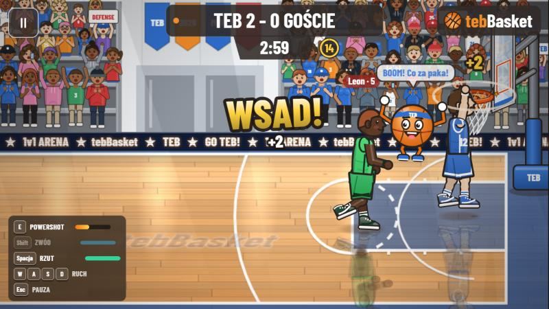

# 🏀 tebBasket

Przeglądarkowa gra zręcznościowa **1 na 1 w koszykówkę** pod marką TEB.
Mecz rysowany w Canvas 2D, menu w React + Tailwind, opcjonalny backend Supabase.
**Gra działa od razu po uruchomieniu — bez zakładania kont i bez internetu.**



---

## ✅ Czego potrzebujesz

1. **Node.js w wersji 18 lub nowszej** (zalecana 20 lub 22 LTS)
   - Pobierz z **https://nodejs.org** → przycisk „LTS” → zainstaluj z domyślnymi opcjami.
   - Razem z Node.js instaluje się `npm` — nic więcej nie trzeba.
   - Sprawdź w terminalu, czy działa:
     ```bash
     node -v
     ```
     Powinno wypisać np. `v22.16.0`.
2. **Git** — *opcjonalnie*, tylko jeśli chcesz pobierać przez `git clone`
   - Pobierz z **https://git-scm.com** (Windows: „Git for Windows”, domyślne opcje).
   - Bez Gita też się da — patrz sposób B poniżej.
3. **Przeglądarka**: Chrome, Edge, Firefox lub Safari (aktualna wersja).

---

## 📥 Krok 1 — Pobierz projekt

### Sposób A: przez Git (zalecany)

1. Otwórz terminal:
   - **Windows:** menu Start → wpisz `PowerShell` lub `cmd` → Enter
   - **macOS:** Spotlight (⌘ + Spacja) → `Terminal`
   - **Linux:** `Ctrl + Alt + T`
2. Przejdź do folderu, w którym chcesz mieć grę, np.:
   ```bash
   cd Desktop
   ```
3. Pobierz repozytorium:
   ```bash
   git clone https://github.com/KrajziXXX/tebbasket.git
   ```
4. Wejdź do folderu projektu:
   ```bash
   cd tebbasket
   ```

### Sposób B: jako plik ZIP (bez Gita)

1. Wejdź na **https://github.com/KrajziXXX/tebbasket**
2. Kliknij zielony przycisk **`<> Code`** → **Download ZIP**.
3. Rozpakuj archiwum (prawy przycisk → „Wyodrębnij wszystkie”).
4. Otwórz terminal **w rozpakowanym folderze** `tebbasket-main`:
   - **Windows:** otwórz folder w Eksploratorze, kliknij w pasek adresu, wpisz `powershell` i naciśnij Enter.
   - **macOS:** prawy przycisk na folderze → „Nowy terminal w folderze”.

---

## 📦 Krok 2 — Zainstaluj zależności

W folderze projektu wpisz **jeden raz**:

```bash
npm install
```

- Pobiera biblioteki (React, Vite itd.) do folderu `node_modules`.
- Trwa zwykle 30 s – 2 min, zależnie od internetu.
- Ostrzeżenia typu `npm warn` / `npm audit` można zignorować.

---

## ▶️ Krok 3 — Uruchom grę

```bash
npm run dev
```

1. W terminalu pojawi się adres, np.:
   ```
   ➜  Local:   http://localhost:5173/
   ```
2. Otwórz **http://localhost:5173** w przeglądarce (lub kliknij link z `Ctrl` / `⌘`).
3. Wpisz pseudonim (3–16 znaków: litery, cyfry, `_`) → **Graj**.
4. **Nie zamykaj terminala** podczas gry — to on „serwuje” stronę.
5. Aby zakończyć: w terminalu naciśnij **`Ctrl + C`**.

> Postęp (poziom, monety, stroje) zapisuje się w Twojej przeglądarce. Przy kolejnym uruchomieniu wystarczy znów `npm run dev`.

### 📱 Gra na telefonie (w tej samej sieci Wi-Fi)

1. Uruchom `npm run dev` na komputerze.
2. W terminalu znajdź linijkę `➜  Network: http://192.168.x.x:5173/`.
3. Otwórz ten adres w przeglądarce telefonu i **obróć telefon poziomo** — pojawią się przyciski dotykowe.
4. Jeśli strona się nie otwiera: zezwól Node.js na dostęp w zaporze systemu (Windows zapyta przy pierwszym uruchomieniu).

---

## 🎮 Sterowanie

| Akcja | Klawiatura | Telefon |
|---|---|---|
| Ruch | Strzałki / `W` `A` `S` `D` | Krzyżak |
| Rzut / wsad | `Spacja` lub `J` — **przytrzymaj i puść na szczycie wyskoku** (zielone pole) | Przycisk „rzut” |
| Przechwyt / blok (w obronie) | `Spacja` lub `J` | Ten sam przycisk |
| Zwód | `Shift` lub `L` | Przycisk „zwód” |
| Powershot (trafia zawsze) | `E` lub `K` | Przycisk POWER |
| Pauza | `Esc` lub `P` | ⏸ |

**Tryby:** *Trening* (bez przeciwnika) · *Szybki mecz* (łatwiejszy przeciwnik) · *Ranked 1v1* (ranking, najwięcej XP).

---

## 🧪 Testy

```bash
npm test             # 74 testy automatyczne
npm run test:docs    # testy + zapis logu i tabeli przypadków do docs/testy/
```

---

## 🛠️ Inne polecenia

| Polecenie | Co robi |
|---|---|
| `npm run dev` | Uruchamia grę w trybie deweloperskim (http://localhost:5173) |
| `npm run build` | Sprawdza typy i buduje wersję produkcyjną do folderu `dist/` |
| `npm run preview` | Uruchamia zbudowaną wersję z `dist/` (po `npm run build`) |
| `npm test` | Uruchamia testy |
| `npm run typecheck` | Tylko sprawdzenie typów TypeScript |

---

## ❓ Rozwiązywanie problemów

| Problem | Rozwiązanie |
|---|---|
| `node` / `npm` „nie jest rozpoznawany jako polecenie” | Zainstaluj Node.js z nodejs.org, **zamknij i otwórz terminal ponownie** (albo uruchom ponownie komputer). |
| PowerShell: „wykonywanie skryptów jest wyłączone w tym systemie” | Użyj `cmd` zamiast PowerShell **albo** jednorazowo wpisz: `Set-ExecutionPolicy -Scope CurrentUser RemoteSigned` i potwierdź `T`. |
| `npm install` kończy się błędem | Sprawdź `node -v` (musi być ≥ 18). Potem usuń folder `node_modules` i uruchom `npm install` ponownie. |
| `Port 5173 is in use` | Gra jest już uruchomiona w innym terminalu — użyj tamtego adresu albo zamknij go `Ctrl + C`. Vite może też sam wybrać inny port (np. 5174) — użyj adresu z terminala. |
| Biały / czarny ekran | Odśwież stronę (`F5`). Upewnij się, że terminal z `npm run dev` nadal działa. |
| Brak dźwięku | Kliknij raz w stronę (przeglądarki blokują dźwięk do pierwszego kliknięcia) i sprawdź Ustawienia → Dźwięk. |
| Chcę zacząć od zera | Ustawienia → **Resetuj postęp**. |

---

## ☁️ Opcjonalnie: konta i wspólny ranking (Supabase)

Bez tego gra działa w pełni offline. Jeśli chcesz konta i ranking wspólny dla wszystkich:

1. Załóż darmowy projekt na **https://supabase.com**.
2. W **SQL Editor** wklej i uruchom cały plik `supabase/schema.sql`.
3. Skopiuj plik `.env.example` jako `.env.local` i wpisz dane z *Project Settings → API*:
   ```
   VITE_SUPABASE_URL=https://twoj-projekt.supabase.co
   VITE_SUPABASE_ANON_KEY=twój_klucz_anon
   ```
4. Uruchom ponownie `npm run dev`.

Szczegóły (uwierzytelnianie, Realtime, wdrożenie na Vercel): **[SETUP.md](SETUP.md)**.

---

## 📚 Dokumentacja

- **[docs/DOKUMENTACJA.md](docs/DOKUMENTACJA.md)** — pełna dokumentacja projektu: wymagania, architektura, mechanika ze wzorami, baza danych, testy, zrzuty ekranu, instrukcja gracza
- [docs/testy/PRZYPADKI-TESTOWE.md](docs/testy/PRZYPADKI-TESTOWE.md) — wszystkie przypadki testowe z wynikami
- [docs/testy/logi/](docs/testy/logi/) — logi z uruchomienia testów i raporty symulacji
- [SETUP.md](SETUP.md) — konfiguracja backendu i wdrożenie

## 🧰 Technologie

TypeScript · React 18 · Vite 5 · Tailwind CSS 3 · Canvas 2D · Web Audio API · Zustand · Supabase (PostgreSQL + RLS) · Vitest
