<div align="center">

# tebBasket
## Przeglądarkowa gra zręcznościowa 1v1 w koszykówkę

**Dokumentacja projektu**

| | |
|---|---|
| **Autor** | Krystian Wyrwicki , Krzysztof Strzelewicz, Gracjan Nowakowski, Andrzej Ziółkowski |
| **Klasa** | 5E |
| **Wersja dokumentu** | 1.0 |
| **Data** | 27.10.2026 |
| **Repozytorium** | `Lokalnie na komputerze Admina D:\tebbasket` (Git, gałąź `main` private repo) |

</div>

---

## Spis treści

1. [Wprowadzenie](#1-wprowadzenie)
2. [Specyfikacja wymagań](#2-specyfikacja-wymagań)
3. [Technologie](#3-technologie)
4. [Architektura systemu](#4-architektura-systemu)
5. [Opis modułów](#5-opis-modułów)
6. [Mechanika gry](#6-mechanika-gry)
7. [Progresja i ekonomia](#7-progresja-i-ekonomia)
8. [Baza danych i bezpieczeństwo](#8-baza-danych-i-bezpieczeństwo)
9. [Grafika, animacje i dźwięk](#9-grafika-animacje-i-dźwięk)
10. [Interfejs użytkownika](#10-interfejs-użytkownika)
11. [Testy](#11-testy)
12. [Instalacja i uruchomienie](#12-instalacja-i-uruchomienie)
13. [Instrukcja dla gracza](#13-instrukcja-dla-gracza)
14. [Napotkane problemy i ich rozwiązania](#14-napotkane-problemy-i-ich-rozwiązania)
15. [Możliwości rozwoju](#15-możliwości-rozwoju)
16. [Podsumowanie](#16-podsumowanie)
17. [Słowniczek](#17-słowniczek)
18. [Źródła](#18-źródła)

---

## 1. Wprowadzenie

### 1.1. Cel projektu

Celem projektu było zaprojektowanie i zbudowanie kompletnej, przeglądarkowej gry zręcznościowej w koszykówkę jeden na jednego, pod marką szkoły TEB. Gra składa się z dwóch warstw:

- **rozgrywki** – mecz w czasie rzeczywistym, rysowany w 2D (widok z boku, styl kreskówkowy),
- **meta-warstwy** – lobby, konto gracza, poziomy i doświadczenie, waluty, sklep ze strojami, szatnia oraz ranking.

### 1.2. Zakres

Projekt obejmuje:

- trzy tryby gry: **szybki mecz**, **ranked 1v1** (rankingowy) i **trening**,
- pełną pętlę akcji: rzut sędziowski, posiadanie piłki, rzut, wsad, powershot, przechwyt, blok, zwód, zbiórki, zegar akcji, koniec meczu, „złoty kosz” przy remisie,
- przeciwnika sterowanego przez sztuczną inteligencję (NPC), zawsze nieco słabszego od gracza,
- system poziomów, XP, dwie waluty (monety i klejnoty), sklep z 18 strojami i szatnię,
- ranking graczy (lokalny lub wspólny, odświeżany na żywo),
- działanie **bez serwera** (tryb offline) oraz z backendem **Supabase** (konta, baza danych),
- obsługę klawiatury i ekranu dotykowego, dwie wersje językowe (PL/EN),
- 74 testy automatyczne z logami.

Poza zakresem (opisane w rozdziale 15): prawdziwe płatności, gra wieloosobowa przez internet (PvP).

### 1.3. Założenia projektowe

| Założenie | Uzasadnienie |
|---|---|
| Gra działa w przeglądarce, bez instalacji | Łatwo ją pokazać na lekcji i uruchomić na każdym komputerze lub telefonie |
| Cała grafika rysowana kodem (bez plików graficznych) | Brak problemów z prawami autorskimi, mały rozmiar, łatwe zmiany kolorów strojów |
| Logika gry oddzielona od wyświetlania | Silnik można testować automatycznie bez przeglądarki |
| Gra działa offline, a backend jest opcjonalny | Projekt działa „od razu”, bez zakładania kont w zewnętrznych usługach |
| Nagrody liczy serwer, nie przeglądarka | Gracz nie może sobie dopisać monet ani poziomów (rozdz. 8) |

---

## 2. Specyfikacja wymagań

### 2.1. Wymagania funkcjonalne

| ID | Wymaganie | Status | Gdzie w kodzie | Test |
|---|---|---|---|---|
| FR-01 | Gracz loguje się (offline: pseudonim; online: e-mail + hasło) | ✅ | `pages/Login.tsx`, `lib/api.ts` | T-API-01…04 |
| FR-02 | Lobby pokazuje postać, poziom, pasek XP, monety i klejnoty | ✅ | `pages/Lobby.tsx` | — (UI, zrzut 10.2) |
| FR-03 | Trzy tryby gry: szybki mecz, ranked, trening | ✅ | `game/factory.ts` | T-EN-03, T-SIM-01 |
| FR-04 | Rzut sędziowski losowo przydziela piłkę | ✅ | `engine.ts → updateTipoff` | T-EN-01, T-EN-02 |
| FR-05 | Rzut zwykły – szansa zależy od odległości i obrony | ✅ | `engine.ts → shotChance` | T-EN-11 |
| FR-06 | Wsad – automatycznie blisko kosza | ✅ | `engine.ts → control` | T-EN-13 |
| FR-07 | Powershot – trafia zawsze, ładuje się 25 s | ✅ | `engine.ts → startShot/release` | T-EN-12 |
| FR-08 | Przechwyt w obronie, kara za nieudany | ✅ | `engine.ts → trySteal` | T-EN-14…16 |
| FR-09 | Zmiana posiadania po koszu i po przechwycie | ✅ | `engine.ts → scored, toPause` | T-EN-14, T-SIM-01 |
| FR-10 | Zegar meczu (3:00) i koniec meczu | ✅ | `engine.ts → updateLive, finish` | T-EN-03, T-SIM-01 |
| FR-11 | XP zależne od trybu: ranked > quick > trening | ✅ | `lib/progression.ts` | T-PR-06…08 |
| FR-12 | Poziom realnie poprawia umiejętności | ✅ | `statsForLevel` | T-PR-10, T-PR-11 |
| FR-13 | Ranking aktualizowany po meczach rankingowych | ✅ | `api.ts → finishMatch, leaderboard` | T-PR-09, T-API-07, T-API-15, T-API-16 |
| FR-14 | Ustawienia: dźwięk, głośność, nazwa, język | ✅ | `panels/SettingsPanel.tsx` | T-API-14 |
| FR-15 | Szatnia: zmiana stroju i wyglądu | ✅ | `panels/LockerPanel.tsx` | T-API-05, T-API-11 |
| FR-16 | Sklep: stroje + waluta (płatności symulowane) | ✅ | `panels/ShopPanel.tsx` | T-API-10…13 |
| FR-17 | Celownik rzutu (przytrzymaj i puść) | ✅ | `engine.ts → judgeRelease` | T-EN-07…10 |
| FR-18 | Blok, zwód, „w ogniu”, złoty kosz, buzzer beater | ✅ | `engine.ts` | T-EN-05, 06, 17, 18, 19 |
| FR-19 | NPC zawsze słabszy od gracza (quick wyraźnie, ranked trochę) | ✅ | `progression.ts → npcStats` | T-PR-12…15, T-SIM-02…07 |
| FR-20 | Maskotka reaguje na najlepsze zagrania gracza | ✅ | `engine.ts → cheer`, `render.ts` | T-EN-19, T-EN-20 |

### 2.2. Wymagania niefunkcjonalne

| ID | Wymaganie | Jak spełnione |
|---|---|---|
| NFR-01 | Płynność ≥ 60 klatek/s na typowym komputerze | Pomiar: cała klatka meczu ≈ 1,7 ms w 1920×1080 (rozdz. 9.4) |
| NFR-02 | Działanie na telefonie | Kontrolki dotykowe, układ na niskie ekrany, prośba o obrót telefonu (zrzut 10.8) |
| NFR-03 | Bezpieczeństwo danych | Row Level Security, uprawnienia do kolumn, nagrody liczone na serwerze (rozdz. 8) |
| NFR-04 | Działanie bez internetu i serwera | Tryb offline z zapisem w `localStorage` |
| NFR-05 | Dostępność językowa | Pełne tłumaczenie PL/EN (`lib/i18n.ts`) |
| NFR-06 | Jakość kodu | TypeScript w trybie `strict`, 74 testy, build bez ostrzeżeń |
| NFR-07 | Mały rozmiar | Ok. 297 kB JS (97 kB po kompresji gzip), zero plików graficznych |
| NFR-08 | Automatyczne obniżanie jakości na słabym sprzęcie | Tryb `lowQuality` w rendererze (rozdz. 9.4) |

---

## 3. Technologie

| Technologia | Wersja | Do czego | Dlaczego |
|---|---|---|---|
| **TypeScript** | 5.6.3 | Cały kod | Typy wyłapują błędy przed uruchomieniem |
| **React** | 18.3.1 | Ekrany menu (lobby, sklep, szatnia…) | Komponenty, łatwe zarządzanie stanem UI |
| **Vite** | 5.4.21 | Serwer deweloperski i budowanie | Bardzo szybki, przeładowanie na żywo |
| **Tailwind CSS** | 3.4.19 | Wygląd menu | Szybkie stylowanie klasami, spójny design |
| **HTML5 Canvas 2D** | — | Rysowanie meczu i postaci | Pełna kontrola nad każdym pikselem, wydajność |
| **Zustand** | 4.5.7 | Globalny stan (ekran, profil) | Prostszy niż Redux, mały |
| **Supabase** | supabase-js 2.117.3 | Konta, baza PostgreSQL, Realtime | Gotowy backend z bezpieczeństwem na poziomie bazy |
| **Web Audio API** | — | Dźwięki | Dźwięki syntezowane kodem, bez plików |
| **Vitest** | 2.1.9 | Testy automatyczne | Natywnie współpracuje z Vite i TypeScriptem |
| **Git** | — | Kontrola wersji | Historia zmian projektu |

Narzędzia pomocnicze: Visual Studio Code, przeglądarka Chrome (narzędzia deweloperskie), Node.js 22.16, asystent programistyczny AI (Claude Code), z którego korzystano przy pisaniu kodu, testów i dokumentacji.

---

## 4. Architektura systemu

### 4.1. Diagram warstw

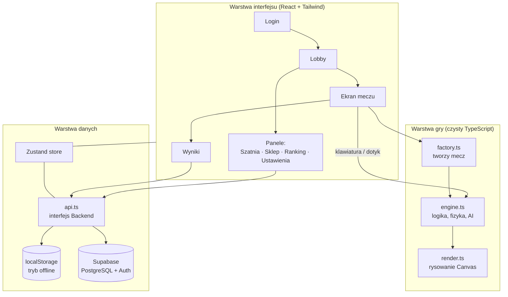

Najważniejsza decyzja architektoniczna: **silnik gry (`engine.ts`) nie wie nic o rysowaniu ani o React**. Przyjmuje tylko „wejście” (ruch, przyciski) i krok czasu, a zwraca stan. Dzięki temu:

- testy rozgrywają całe mecze bez przeglądarki (rozdz. 11),
- renderer tylko odczytuje stan i rysuje, więc można go zmieniać bez ryzyka zepsucia zasad gry.

### 4.2. Przepływ danych w meczu (jedna klatka)

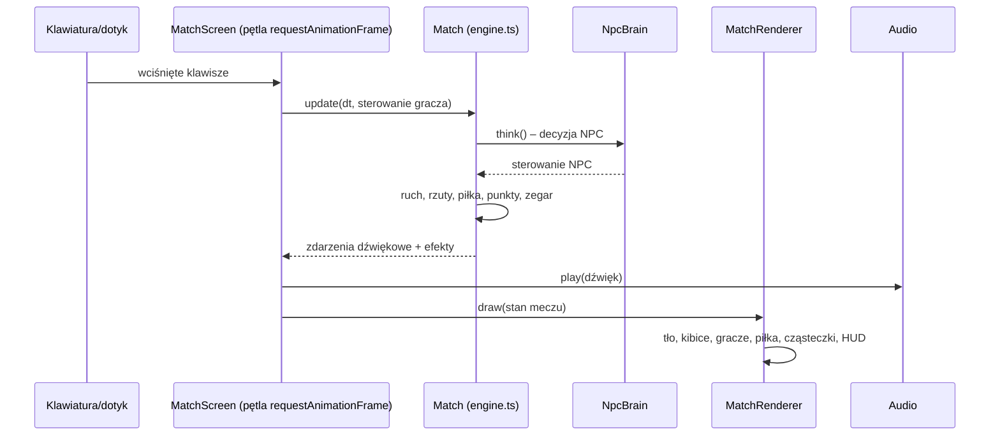

### 4.3. Tryb offline i online

Interfejs `Backend` w `lib/api.ts` ma dwie implementacje z identycznymi metodami:

| Metoda | `LocalBackend` (offline) | `SupabaseBackend` (online) |
|---|---|---|
| logowanie | pseudonim, bez hasła | e-mail + hasło (Supabase Auth) |
| zapis profilu | `localStorage` przeglądarki | tabela `profiles` |
| nagrody za mecz | liczone w przeglądarce | liczone przez funkcję SQL `finish_match()` |
| ranking | lokalny, z przykładowymi graczami | wspólny dla wszystkich + odświeżanie na żywo |

Wybór następuje automatycznie: jeśli w pliku `.env.local` są dane Supabase, gra używa serwera, a w przeciwnym razie trybu offline.

### 4.4. Struktura katalogów

```
tebbasket/
├── src/
│   ├── game/                 silnik gry (bez Reacta)
│   │   ├── constants.ts      wymiary boiska, kosz, fizyka
│   │   ├── engine.ts         Match, Athlete, Ball, NpcBrain – zasady i AI
│   │   ├── render.ts         rysowanie: hala, kibice, gracze, kosz, efekty, HUD
│   │   └── factory.ts        tworzenie meczu z profilu gracza
│   ├── lib/
│   │   ├── api.ts            backend offline/online (wspólny interfejs)
│   │   ├── progression.ts    XP, poziomy, nagrody, balans NPC
│   │   ├── outfits.ts        stroje, wygląd, cennik
│   │   ├── audio.ts          dźwięki syntezowane (Web Audio)
│   │   ├── i18n.ts           tłumaczenia PL/EN
│   │   ├── actions.ts        zapis meczu, aktualizacja profilu
│   │   └── supabase.ts       klient Supabase (null = offline)
│   ├── pages/                ekrany: Login, Lobby, MatchScreen, Results, panels/*
│   ├── components/           płótna (tło, postać, awatar), ikony, elementy UI
│   ├── store/useGame.ts      stan globalny (Zustand)
│   └── types/index.ts        wspólne typy danych
├── tests/                    testy automatyczne (Vitest) + generator danych testowych
├── scripts/                  skrypty: zapis logu testów, generowanie tabeli przypadków
├── supabase/schema.sql       cała baza danych: tabele, RLS, funkcje
├── docs/                     ta dokumentacja, zrzuty ekranu, logi testów
└── SETUP.md                  instrukcja konfiguracji i wdrożenia
```

Rozmiar kodu: ok. **7 700 linii** kodu aplikacji, **1 040 linii** testów i **300 linii** SQL.

---

## 5. Opis modułów

### 5.1. `game/engine.ts` – silnik gry (≈1 300 linii)

| Klasa / funkcja | Odpowiedzialność |
|---|---|
| `Match` | Cały mecz: fazy, zegar, wynik, statystyki, posiadanie, zdarzenia. Metoda `update(dt, controls)` to jeden krok symulacji. |
| `Athlete` | Zawodnik: pozycja (x, z, wysokość h), stan (`idle`, `run`, `shoot`, `dunk`, `hang`, `block`, `fall`…), zmęczenie po akcjach (`stunT`, cooldowny), pasek powershotu, seria „w ogniu”. |
| `Ball` | Piłka: trzymana, w locie, „tańcząca” na obręczy, luźna (do zbiórki), przechodząca przez siatkę. |
| `NpcBrain` | Sztuczna inteligencja: wybór miejsca ataku, decyzja o rzucie, zwody, krycie, przechwyty, bloki. Siłę ustawia parametr `diff` (0–1). |
| `judgeRelease` | Ocena momentu puszczenia rzutu (idealnie/dobrze/za wcześnie/za późno). |
| `shotChance` | Wzór na szansę trafienia (rozdz. 6.4). |

### 5.2. `game/render.ts` – grafika (≈3 600 linii)

Rysuje wszystko na płótnie Canvas: halę (okna, trybuny, parkiet, linie boiska), kibiców, zawodników z przodu i z boku, kosz, piłkę, cząsteczki, kamerę i HUD. Szczegóły w rozdziale 9.

### 5.3. `game/factory.ts`

Tworzy mecz na podstawie profilu: zawodnik gracza dostaje statystyki z poziomu, a przeciwnik (NPC) losowe imię, strój kontrastujący z graczem oraz statystyki obniżone względem gracza.

### 5.4. `lib/progression.ts`

Wszystkie liczby ekonomii i balansu w jednym miejscu: nagrody za mecze, progi XP, statystyki z poziomu, osłabienie NPC (`NPC_HANDICAP`). Te same wartości są zapisane w funkcji SQL `finish_match()`, a test T-SQL-02 pilnuje, żeby się nie rozjechały.

### 5.5. `lib/api.ts`

Wspólny interfejs `Backend` (logowanie, profil, mecz, sklep, ranking) z dwiema implementacjami opisanymi w rozdz. 4.3.

### 5.6. Pozostałe moduły

| Plik | Opis |
|---|---|
| `lib/outfits.ts` | 18 strojów (kolory, wzory: paski, gradient, gwiazdki, szarfa), ceny, karnacje, fryzury |
| `lib/audio.ts` | 18 rodzajów dźwięków generowanych oscylatorami i szumem (kozłowanie, siatka, obręcz, pisk butów, syrena, wiwaty, szum trybun) |
| `lib/i18n.ts` | Słowniki PL/EN, hook `useT()` |
| `store/useGame.ts` | Stan aplikacji: bieżący ekran, otwarty panel, profil, ostatni mecz, komunikaty |
| `pages/MatchScreen.tsx` | Pętla gry, obsługa klawiatury i dotyku, panel cooldownów, adaptacyjna jakość |
| `components/Canvases.tsx` | Tło hali w lobby, podgląd postaci w szatni, awatar, konfetti |

---

## 6. Mechanika gry

### 6.1. Fazy meczu

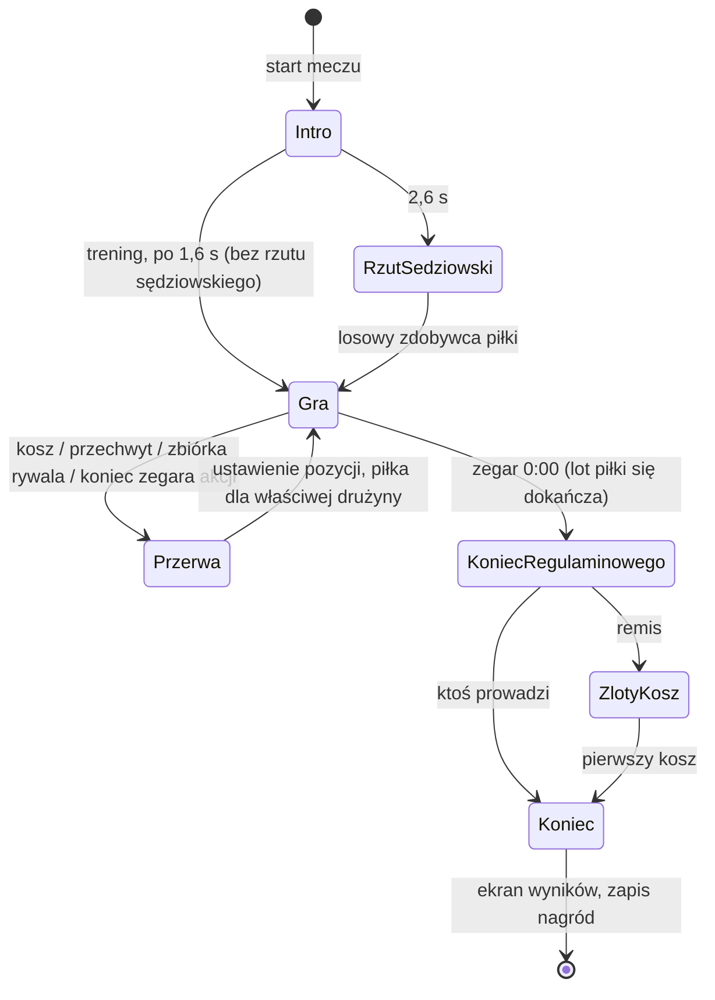

### 6.2. Układ współrzędnych

Boisko jest widziane z boku. Każdy obiekt ma trzy współrzędne:

- `x` – pozycja wzdłuż boiska (0–960 px, kosz na `x = 858`),
- `z` – głębokość, od dalszej linii bocznej (0) do bliższej (1),
- `h` – wysokość nad parkietem (skok, lot piłki).

Na ekranie: `y = floorY(z) − h`, a postaci dalej od widza są lekko mniejsze (`persp(z) = 0,9 + 0,3·z`). Odległość „w świecie” liczy się wzorem:

$$d = \sqrt{(x_1-x_2)^2 + \big((z_1-z_2)\cdot 260\big)^2}$$

### 6.3. Sterowanie

| Akcja | Klawiatura | Dotyk |
|---|---|---|
| Ruch | strzałki / WASD | krzyżak (obsługuje skosy) |
| Rzut / wsad | Spacja lub J (przytrzymaj = celownik) | przycisk „rzut” / „wsad” |
| Przechwyt / blok (w obronie) | Spacja lub J | ten sam przycisk |
| Zwód | Shift lub L | przycisk „zwód” |
| Powershot | E lub K | przycisk POWER |
| Pauza | Esc lub P | ⏸ |

### 6.4. Szansa trafienia rzutu

Dla rzutu z odległości `d` od kosza:

$$p = \text{clamp}\big(0{,}82 - (d - 70)\cdot 0{,}00135;\ 0{,}08;\ 0{,}82\big) + \text{bonus}_{poziom} + \text{bonus}_{ogień} + \text{bonus}_{celownik} - \text{krycie}$$

- **bonus za poziom:** 0,005 na poziom, maksymalnie +0,15,
- **„w ogniu”:** +0,10,
- **celownik:** idealnie +0,20, dobrze +0,06, za wcześnie lub za późno −0,14, szybkie kliknięcie 0,
- **krycie:** gdy obrońca jest bliżej niż 100 px, `(1 − d_obr/100) · 0,30` (jeśli stoi między rzucającym a koszem) albo `· 0,12` (z boku),
- **wynik końcowy** jest ograniczony do przedziału [0,04; 0,97],
- **punkty:** 3 za rzut zza linii (d > 330), w pozostałych przypadkach 2.

Przykład: rzut z linii za 3 pkt (d = 330) bez krycia na poziomie 1 daje `0,82 − 260·0,00135 ≈ 0,47`, czyli 47%.

### 6.5. Celownik rzutu

Rzut zaczyna się wyskokiem. Szczyt wyskoku wypada po **0,36 s**. Gracz, który przytrzyma przycisk i puści go:

| Moment puszczenia | Ocena | Wpływ |
|---|---|---|
| 0,36 s ± 0,045 s | IDEALNIE (zielone pole) | +20 punktów procentowych |
| ± 0,11 s | DOBRZE (żółte pole) | +6 pp |
| wcześniej / później | ZA WCZEŚNIE / ZA PÓŹNO | −14 pp |
| kliknięcie krótsze niż 0,11 s | zwykły rzut | 0 |
| trzymanie ponad 0,66 s | automatycznie ZA PÓŹNO | −14 pp |

### 6.6. Zagrania specjalne

| Zagranie | Warunek | Działanie | Ograniczenie |
|---|---|---|---|
| **Wsad** | odległość od kosza < 105 px | bazowo 86%; zawodnik wisi na obręczy 0,42 s, obręcz się ugina, ekran drga | krycie działa w 70% |
| **Powershot** | pasek pełny | trafia zawsze (100%), ognisty ślad piłki | pasek ładuje się 25 s i zużywa w całości; nie da się go zablokować |
| **Przechwyt** | obrońca bliżej niż 75 px | `p = 0,30 + przechwyt_obr − 0,5·przechwyt_atak` (+0,06 przy ustawieniu na wprost), ograniczone do [0,10; 0,60] | odnowienie 0,85 s; nieudany spowalnia obrońcę na 0,45 s; nie działa w trakcie zwodu |
| **Blok** | obrońca jest w powietrzu przy wypuszczeniu piłki, bliżej niż 82 px | `p = 0,62 − d/160 + przechwyt_obr`, przy wsadzie ×0,6, w przedziale [0,05; 0,70] | odnowienie 1 s |
| **Zwód** | posiadanie piłki | zryw w bok przez 0,34 s; szansa przewrócenia obrońcy `0,12 + 0,006·Δpoziom + 0,4·rzut` (+0,30, gdy obrońca sięga po piłkę) | odnowienie 2,2 s; obrońca leży 0,95 s |
| **W ogniu** | 3 kosze z rzędu bez odpowiedzi rywala | +10 pp do rzutów, powershot ładuje się 1,8× szybciej | gaśnie po koszu rywala (w treningu po pudle) |
| **Buzzer beater** | piłka w locie w chwili syreny | rzut się liczy, zwolnione tempo (×0,38) | — |
| **Złoty kosz** | remis po czasie | gra bez zegara do pierwszego kosza | — |

Dodatkowe zasady: **zegar akcji** to 14 s na rzut, po czym piłka przechodzi do rywala. **Zbiórka**: po pudle piłka odbija się od obręczy. Kto ją złapie, ten atakuje (zbiórka w ataku przedłuża akcję). Przy zwykłych rzutach w 22% trafień i 50% pudeł piłka „tańczy” 1–2 razy na obręczy, zanim wpadnie albo wypadnie.

### 6.7. Sztuczna inteligencja przeciwnika

`NpcBrain.think()` wywoływana co klatkę zwraca sterowanie tak samo jak klawiatura:

- **w ataku:** co 1–2,3 s wybiera cel (wejście pod kosz, rzut z półdystansu albo zza linii za 3) i omija obrońcę ruchem w głąb boiska. Czasem robi zwód. Rzuca, gdy szansa przekracza próg zależny od `diff`, a pod koniec zegara akcji rzuca na siłę,
- **w obronie:** trzyma się między rywalem a koszem i co jakiś czas doskakuje do przechwytu. Gdy rywal rzuca, może skoczyć do bloku z opóźnieniem zależnym od `diff`,
- **piłka luźna / w locie:** biegnie do zbiórki.

Parametr `diff` (0–1) wpływa na szybkość reakcji, częstotliwość przechwytów i bloków oraz trafianie w okno idealnego rzutu.

### 6.8. Balans – NPC zawsze słabszy od gracza

Statystyki NPC są liczone **od statystyk gracza**:

| | Szybki mecz | Ranked 1v1 |
|---|---|---|
| Szybkość | −8% | −3% |
| Skuteczność rzutów | −10 pp | −4 pp |
| Przechwyty | −7 pp | −3 pp |
| Poziom NPC | 1–3 niżej | 0–1 niżej |
| Inteligencja AI (`diff`) | 0,20 | 0,28–0,36, rośnie z rankingiem, zawsze poniżej 0,40 |

Skuteczność tego ustawienia potwierdzają symulacje (rozdz. 11.6).

---

## 7. Progresja i ekonomia

### 7.1. Doświadczenie i poziomy

Próg do następnego poziomu: `XP(lvl) = 100 + (lvl − 1) · 40`, czyli 100, 140, 180, 220…

| Tryb | Wygrana | Przegrana |
|---|---|---|
| Ranked 1v1 | **120 XP**, 60 monet, ranking +20…+30 | 45 XP, 15 monet, ranking −15 |
| Szybki mecz | **70 XP**, 35 monet | 25 XP, 10 monet |
| Trening | 5 XP + 1 za celny rzut (maks. **20 XP**), 5 monet | — |

Spełnia to wymaganie specyfikacji **ranked > quick > trening**: nawet przegrany szybki mecz (25 XP) daje więcej niż najlepszy trening (20 XP).

Zmiana rankingu za wygraną to `+20 + min(10, ⌊przewaga/2⌋)`, a za przegraną zawsze −15. Ranking startuje od 1000 i nie spada poniżej 0.

### 7.2. Wpływ poziomu na grę

| Statystyka | Na poziom | Maksimum |
|---|---|---|
| Szybkość | +0,4% | +12% |
| Skuteczność rzutów | +0,5 pp | +15 pp |
| Skuteczność przechwytów i bloków | +0,4 pp | +10 pp |

### 7.3. Waluty i sklep

- Konto startuje z **0 monet i 0 klejnotów**.
- Monety zdobywa się za mecze. Klejnoty: **+10 za każdy awans** (jedyne darmowe źródło).
- **Sklep:** 16 płatnych strojów (monety 250–2000 albo klejnoty 40–150) i 2 darmowe startowe.
- **Wymiana:** 10 klejnotów → 1000 monet, 50 → 5500, 100 → 12 000.
- **Pakiety klejnotów za złotówki** są tylko symulowane (bez prawdziwych płatności).

Przykład: najtańszy strój (250 monet) to około 7 wygranych szybkich meczów.

---

## 8. Baza danych i bezpieczeństwo

### 8.1. Model danych

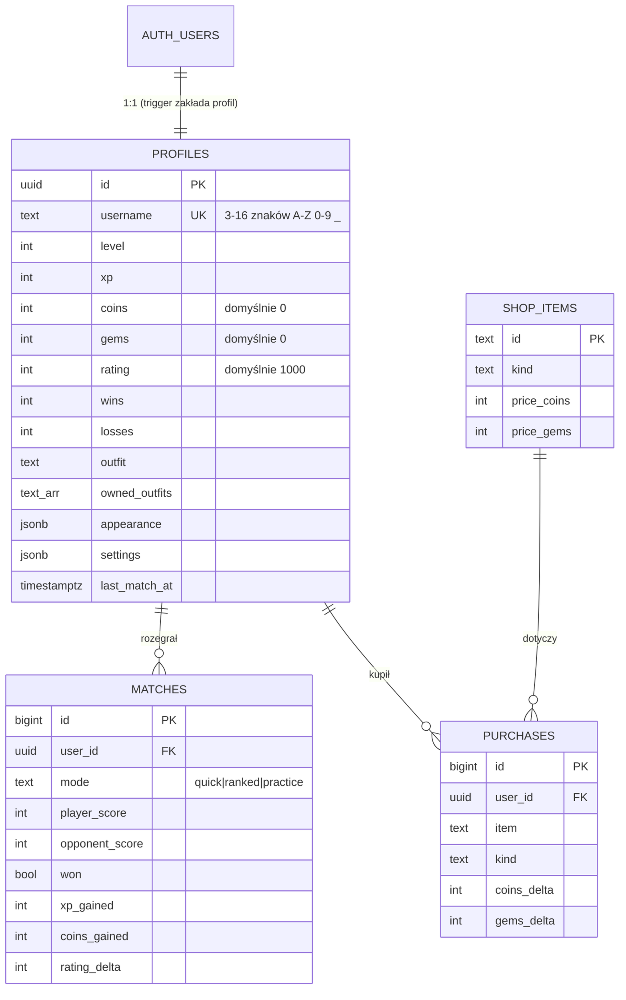

### 8.2. Model bezpieczeństwa

Podstawowa zasada: **przeglądarce gracza nie można ufać**, bo każdy może zmienić jej kod. Dlatego:

1. **Row Level Security (RLS)** jest włączone na wszystkich tabelach. Gracz widzi tylko swój profil, swoje mecze i zakupy (`id = auth.uid()`).
2. **Uprawnienia do kolumn:** gracz może zmieniać wyłącznie `username`, `outfit`, `appearance` i `settings`. Kolumny `coins`, `gems`, `xp`, `level` i `rating` są dla niego tylko do odczytu.
3. **Funkcje `SECURITY DEFINER`** zmieniają walutę i postęp, a wartości wyliczają same:

| Funkcja | Działanie | Zabezpieczenia |
|---|---|---|
| `finish_match(mode, wynik, wynik_rywala, celne)` | liczy XP, monety, klejnoty, awanse i ranking | wynik 0–200, kolejny mecz najwcześniej po 150 s (trening po 90 s) |
| `buy_outfit(id)` | kupuje strój po cenie z tabeli `shop_items` | blokada wiersza `FOR UPDATE`, sprawdzenie środków |
| `exchange_gems(pakiet)` | wymienia klejnoty na monety | sprawdzenie salda w tym samym `UPDATE` |
| `mock_purchase(pakiet)` | symulowany zakup klejnotów | **tylko demo**, przed produkcją do usunięcia |
| `get_leaderboard(limit)` | publiczny ranking | zwraca tylko nazwę, poziom, ranking i liczbę wygranych |

4. **Trigger `profiles_guard`** nie pozwala założyć stroju, którego gracz nie kupił.
5. W kodzie gry jest tylko publiczny klucz `anon`. Klucz administracyjny `service_role` nigdy nie trafia do przeglądarki.

**Znane ograniczenie:** NPC działa w przeglądarce, więc wynik meczu podaje klient. Serwer sprawdza zakres i częstotliwość, ale nie może sprawdzić samego przebiegu meczu. Pełne rozwiązanie wymaga serwera gry (PvP, rozdz. 15).

### 8.3. Zapis meczu – przebieg

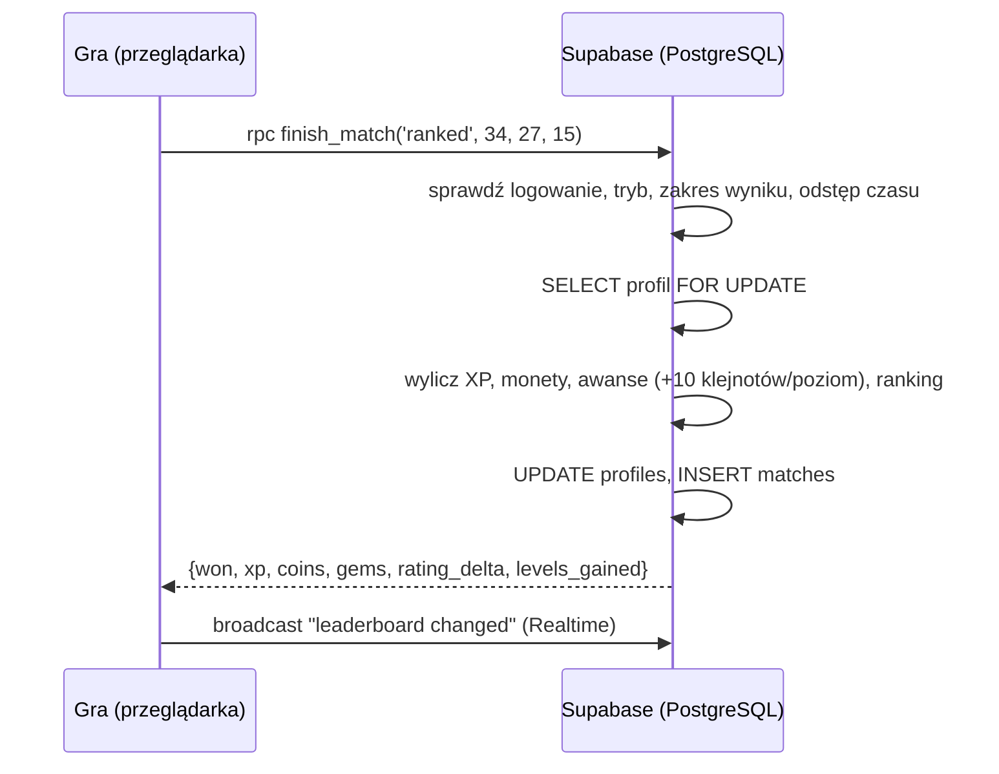

---

## 9. Grafika, animacje i dźwięk

### 9.1. Grafika proceduralna

Gra nie używa ani jednego pliku graficznego. Wszystko jest rysowane funkcjami Canvas 2D (ścieżki, krzywe Béziera, gradienty):

- **zawodnicy:** dwa warianty, z boku (w meczu) i z przodu (lobby, szatnia). Kończyny się zwężają (biceps, łydka), są wysokie sneakersy, koszulka z gradientem, wzorem i fałdami, spodenki z nogawkami podążającymi za udami, a do tego cieniowanie, połysk włosów i mruganie oczami,
- **hala:** okna ze smugami światła, banery, trybuny z plastikowymi krzesełkami, ok. 100 zróżnicowanych kibiców (kobiety, mężczyźni, dzieci; fryzury, czapki, okulary, telefony, szaliki, transparenty) i banda LED z przewijanym napisem,
- **parkiet:** pojedyncze deski klonowe z usłojeniem i sękami, lakier z odbiciami okien, niebieskie pole autu, linie z cieniem,
- **kosz:** szklana tablica w rzucie 3/4, słup z obiciem, obręcz z mocowaniem i siatka z prawdziwym splotem.

### 9.2. Kolejność rysowania (jedna klatka)

1. tło z pamięci podręcznej (ściana, trybuny, parkiet, linie),
2. warstwa kibiców (odświeżana 15–30 razy na sekundę),
3. banda LED i słup kosza,
4. odbicia zawodników w parkiecie,
5. cienie,
6. tablica i tylna połowa obręczy,
7. zawodnicy i piłka posortowani po głębokości `z`,
8. przednia połowa obręczy i siatka (piłka „wpada” do kosza),
9. cząsteczki (kurz, iskry, płomienie, pierścienie),
10. etykiety, celownik, winieta,
11. HUD: tablica wyników, zegar, napisy, maskotka.

### 9.3. Animacje i efekty

- pozy: bieg, kozłowanie, rzut z wyrzutem nadgarstka, wsad, zawis na obręczy, blok, przechwyt, zwód, upadek, krok obronny, radość, zmartwienie,
- **squash & stretch:** spłaszczenie przy lądowaniu i rozciągnięcie przy wyskoku,
- **kamera:** delikatne podążanie za akcją, przybliżenie przy wsadzie, drgania ekranu,
- **hitstop** (krótkie zamrożenie, ok. 0,1 s) przy wsadzie, bloku i zwodzie oraz **zwolnione tempo** przy buzzer beaterze,
- cząsteczki: kurz, iskry, płomienie („w ogniu”), flesze aparatów na trybunach, konfetti po wygranej,
- maskotka **Kosiu** (żywa piłka TEB) reagująca na 10 rodzajów zagrań własną pozą, miną i tekstem w dymku.

### 9.4. Optymalizacja wydajności

Pomiary wykonano w przeglądarce Chrome na komputerze autora, w rozdzielczości 1920×1080:

| Element | Przed optymalizacją | Po optymalizacji | Technika |
|---|---|---|---|
| Kibice (~100 postaci) | **41 ms** w każdej klatce | **1,6 ms**, 15–30 razy/s | każdy kibic narysowany raz do własnego obrazka, a w każdej klatce dorysowane tylko ręce, usta i rekwizyty |
| Napis na bandzie LED | rozmycie (`shadowBlur`) co klatkę | gotowy obrazek | pre-rendering |
| Płomienie i flesze | nowy gradient dla każdej cząsteczki | 3 gotowe obrazki | cache sprite'ów |
| Statyczne tło | — | rysowane raz | cache całej hali |
| **Cała klatka meczu** | — | **ok. 1,7 ms** | (60 kl./s wymaga < 16,7 ms) |

Dodatkowo gra mierzy własny czas pracy na klatkę. Jeśli przez ok. 2 s przekracza on 12 ms, gra automatycznie wyłącza odbicia, ogranicza płomienie i zmniejsza rozdzielczość.

### 9.5. Dźwięk

Wszystkie dźwięki są syntezowane przez Web Audio API (oscylatory + filtrowany szum): kozłowanie, odbicie, „swish” siatki, obręcz, wsad, blok, przechwyt, pisk butów, gwizdek, syrena, wiwaty, „ooh” trybun, zapłon ognia, dźwięk idealnego rzutu oraz ciągły szum widowni, którego głośność rośnie przy emocjach.

---

## 10. Interfejs użytkownika

### 10.1. Logowanie
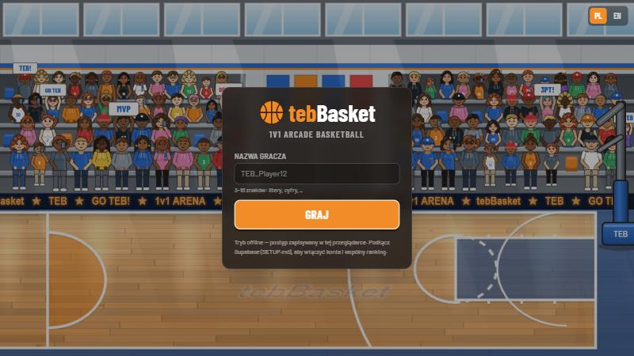

W trybie offline wystarczy pseudonim. W prawym górnym rogu można wybrać język.

### 10.2. Lobby
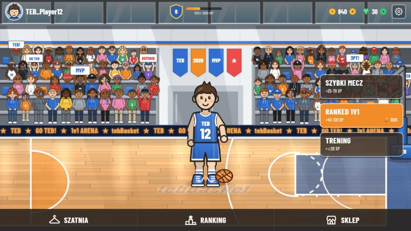

U góry: awatar, nazwa, poziom z paskiem XP, monety, klejnoty i ustawienia. Na środku postać kozłuje, kręci piłką na palcu i trzyma ją. Po prawej są tryby gry, a na dole Szatnia, Ranking i Sklep.

### 10.3. Szatnia
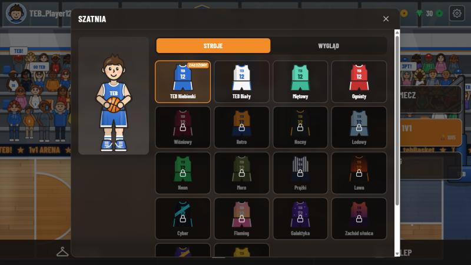

Zmiana stroju (niekupione są zablokowane), karnacji, fryzury, koloru włosów i numeru.

### 10.4. Sklep
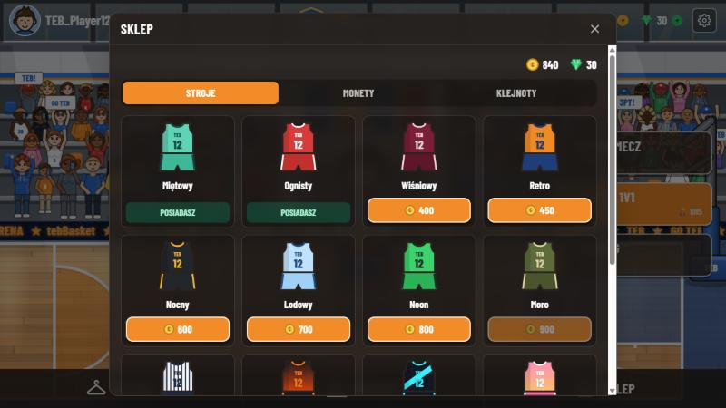

Trzy zakładki: stroje, monety (wymiana klejnotów) i klejnoty (zakup symulowany). Przyciski są wyszarzone, gdy brakuje środków.

### 10.5. Ranking i ustawienia
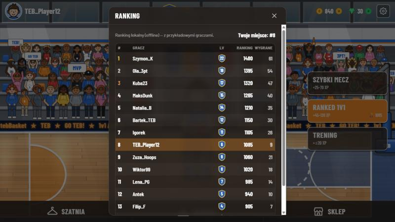
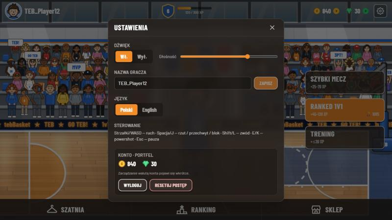

### 10.6. Mecz
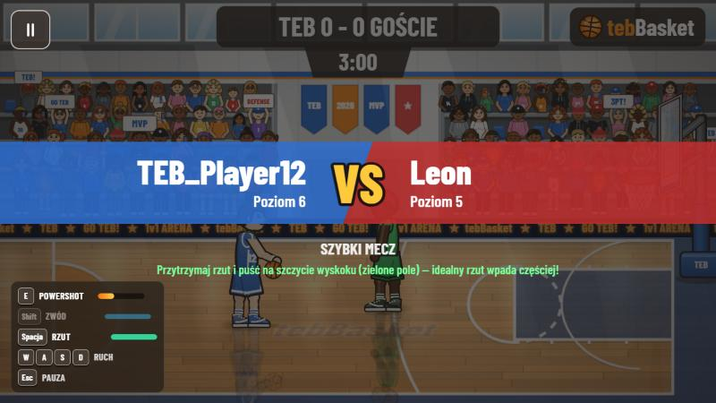

Przed meczem pojawia się karta „VS” z poziomami obu graczy i podpowiedzią o celowniku.

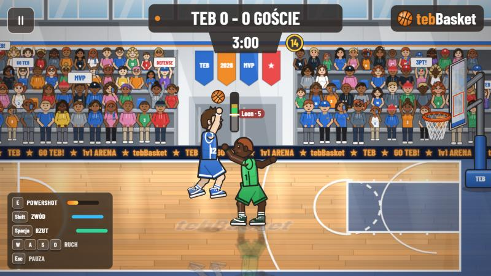

Celownik obok rzucającego. Obrońca skacze do bloku. W lewym dolnym rogu jest panel klawiszy z paskami odnowienia.


Wsad: zawodnik wisi na obręczy, pojawia się napis „WSAD!”, a maskotka Kosiu mówi „BOOM! Co za paka!”.

### 10.7. Wyniki
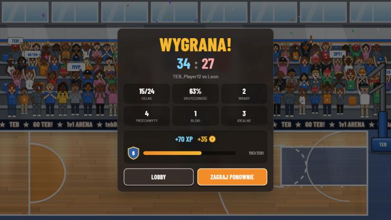

Wynik, statystyki (celne, skuteczność, wsady, przechwyty, bloki, idealne rzuty), nagrody, animowany pasek XP i konfetti przy wygranej.

### 10.8. Telefon
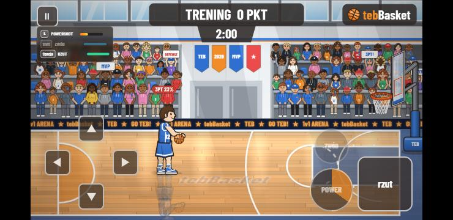

Na ekranach dotykowych pojawiają się krzyżak i przyciski akcji, a panel cooldownów przenosi się na górę.

> Zrzuty wykonano na profilu demonstracyjnym (poziom 6, 840 monet), żeby pokazać sklep i szatnię z częścią odblokowanych strojów.

---

## 11. Testy

### 11.1. Strategia testowania

| Poziom | Co sprawdza | Narzędzie | Liczba testów |
|---|---|---|---|
| **Testy jednostkowe** | pojedyncze funkcje: wzory XP, nagrody, ocena celownika, szansa rzutu, katalog strojów | Vitest | 26 |
| **Testy scenariuszowe silnika** | konkretne sytuacje w meczu: przechwyt, blok, zwód, wsad, buzzer beater, złoty kosz | Vitest + sterowany generator losowy | 18 |
| **Testy integracyjne** | backend offline (konto → mecz → nagrody → sklep → ranking), zgodność gry z bazą SQL | Vitest + atrapa `localStorage` | 16 + 6 |
| **Symulacje** | 60 pełnych meczów + turniej 12 fikcyjnych graczy: balans i stabilność | Vitest + bot | 8 |
| **Testy manualne** | wygląd, płynność, sterowanie dotykiem | przeglądarka, zrzuty ekranu | rozdz. 10 |

**Razem: 74 testy automatyczne, wszystkie zaliczone.** Pełna lista z wynikami: [`testy/PRZYPADKI-TESTOWE.md`](testy/PRZYPADKI-TESTOWE.md).

### 11.2. Powtarzalność – generator losowy z ziarnem

Gra używa losowości (rzut sędziowski, trafienia, decyzje AI). Żeby testy dawały zawsze ten sam wynik, test podmienia `Math.random` na generator **mulberry32** z ustalonym ziarnem (`seedRandom(seed)`) albo na stałą wartość (`fixRandom(0)` oznacza, że każde losowanie się udaje). Każdy mecz w raporcie symulacji ma zapisane swoje ziarno, więc można go odtworzyć.

### 11.3. Dane testowe (fake data)

Plik `tests/helpers.ts` zawiera generatory **fikcyjnych danych**:

- `fakePlayers(n, seed)` tworzy graczy z wymyślonymi nickami (np. `Hania23`, `MajaDunk`), poziomami, rankingami i bilansem,
- `fakeProfile()` tworzy profil gracza z dowolnymi nadpisanymi polami,
- `bareMatch()`, `giveBall()` i `stepUntil()` ustawiają mecz w konkretnej sytuacji (np. „gracz ma piłkę 40 px od obrońcy”).

Dane wejściowe są fikcyjne, ale **wszystkie wyniki w logach pochodzą z prawdziwego uruchomienia** kodu gry.

### 11.4. Przykłady testów

**Test jednostkowy** (`tests/progression.test.ts`):
```ts
it('T-PR-06 hierarchia XP ze specyfikacji: ranked > quick > trening', () => {
  const ranked = computeRewards('ranked', 30, 20, 0).xp
  const quick = computeRewards('quick', 30, 20, 0).xp
  const practiceMax = computeRewards('practice', 99, 0, 999).xp
  expect(ranked).toBeGreaterThan(quick)
  expect(quick).toBeGreaterThan(practiceMax)
})
```

**Test scenariuszowy** (`tests/engine.test.ts`) – idealny rzut z celownikiem:
```ts
it('T-EN-08 przytrzymanie i puszczenie na szczycie = rzut „IDEALNIE”', () => {
  seedRandom(5)
  const m = bareMatch()
  giveBall(m, 'home')
  m.update(DT, press({ action: true, actionHeld: true }))            // wciśnięcie
  for (let i = 0; i < Math.round(PERFECT_T / DT) - 1; i++)
    m.update(DT, press({ actionHeld: true }))                         // trzymanie ~0,36 s
  m.update(DT, NO_INPUT)                                              // puszczenie
  expect(m.home.meter?.q).toBe('perfect')
})
```

**Test integracyjny klient–serwer** (`tests/outfits.test.ts`): test czyta plik `supabase/schema.sql` i sprawdza, czy ceny strojów, nagrody XP i klejnoty za awans w bazie są identyczne jak w kodzie gry.

### 11.5. Wyniki

Log z uruchomienia: [`testy/logi/przebieg-testow.log`](testy/logi/przebieg-testow.log)

| Moduł | Testy | Zaliczone |
|---|---|---|
| Silnik gry | 20 | 20 |
| Progresja i balans | 15 | 15 |
| Stroje + zgodność z bazą | 15 | 15 |
| Backend offline | 16 | 16 |
| Symulacje meczów | 8 | 8 |
| **Razem** | **74** | **74 (100%)** |

### 11.6. Symulacje balansu

Za gracza gra bot o średnich umiejętnościach (`NpcBrain(0.4)`), a NPC jest tworzony dokładnie jak w grze. Rozegrano po 10 pełnych meczów na każdą konfigurację. Raport: [`testy/logi/symulacja-balansu.md`](testy/logi/symulacja-balansu.md)

| Tryb | Poziom gracza | Ranking | AI NPC | Wygrane gracza | Średni wynik | Przewaga |
|---|---|---|---|---|---|---|
| Szybki | 1 | 1000 | 0,20 | 9/10 | 38,3 : 28,0 | +10,3 |
| Szybki | 10 | 1000 | 0,20 | 10/10 | 40,2 : 27,8 | +12,4 |
| Szybki | 25 | 1000 | 0,20 | 10/10 | 44,8 : 31,1 | +13,7 |
| Ranked | 5 | 1000 | 0,28 | 9/10 | 37,8 : 33,3 | +4,5 |
| Ranked | 15 | 1500 | 0,36 | 8/10 | 41,6 : 35,6 | +6,0 |
| Ranked | 25 | 2000 | 0,36 | 7/10 | 43,5 : 39,4 | +4,1 |

**Wniosek:** w szybkim meczu przeciętny gracz wygrywa 97% meczów (średnio +12 pkt), a w rankingowym 80% (średnio +5 pkt). NPC jest więc zawsze słabszy, w szybkim meczu wyraźnie, a w rankingowym tylko trochę, zgodnie z wymaganiem FR-19. NPC zdobywa jednak ok. 28–39 punktów na mecz, więc stawia opór.

Dodatkowo [`turniej-fikcyjnych-graczy.md`](testy/logi/turniej-fikcyjnych-graczy.md) pokazuje 12 fikcyjnych graczy, każdy z jednym meczem rankingowym, z przeliczonym rankingiem i XP.

### 11.7. Błąd wykryty przez testy

Pierwsza wersja symulacji wykazała, że **przy rankingu 2000 NPC przestawał być słabszy**: gracz wygrywał tylko 5/10 meczów przy średniej przewadze −0,5 pkt. Przyczyna: limit inteligencji AI w trybie rankingowym (0,42) był wyższy niż poziom przeciętnego gracza (0,40).

Poprawka: limit obniżono do **0,36**. Dodano test **T-SIM-07**, który sprawdza przewagę gracza w *każdej* konfiguracji osobno, a nie tylko średnio. Prawdziwy log z wersji przed poprawką, w którym ten test nie przechodzi: [`testy/logi/blad-przed-poprawka.log`](testy/logi/blad-przed-poprawka.log)

```
× T-SIM-07 w KAŻDEJ konfiguracji (poziom/ranking) gracz ma przewagę — NPC nigdy nie jest silniejszy
  → ranked lvl 25 ranking 2000: expected 0.5 to be greater than or equal to 0.6
Tests  1 failed | 7 passed (8)
```

### 11.8. Jak uruchomić testy

```bash
npm test              # wszystkie testy w konsoli
npm run test:log      # testy + zapis logu do docs/testy/logi/przebieg-testow.log
npm run test:docs     # log + odświeżenie tabeli docs/testy/PRZYPADKI-TESTOWE.md
```

---

## 12. Instalacja i uruchomienie

Wymagania: **Node.js 18+**.

```bash
npm install        # instalacja zależności
npm run dev        # uruchomienie, gra pod adresem http://localhost:5173
npm run build      # sprawdzenie typów + wersja produkcyjna w folderze dist/
```

Gra działa od razu w trybie offline. Aby włączyć konta i wspólny ranking, trzeba:

1. założyć projekt na supabase.com,
2. w SQL Editorze uruchomić cały plik `supabase/schema.sql`,
3. skopiować `.env.example` do `.env.local` i wpisać `VITE_SUPABASE_URL` oraz `VITE_SUPABASE_ANON_KEY`.

Szczegóły (uwierzytelnianie, Realtime, wdrożenie na Vercel) są w pliku [`SETUP.md`](../SETUP.md).

---

## 13. Instrukcja dla gracza

1. **Wejdź do gry:** wpisz pseudonim (3–16 znaków) i kliknij **Graj**.
2. **Wybierz tryb:** *Trening*, żeby poćwiczyć bez przeciwnika, *Szybki mecz* na luźną grę albo *Ranked 1v1*, żeby zdobyć ranking i najwięcej XP.
3. **Atakuj:** podejdź bliżej kosza (nad głową widać szansę trafienia). **Przytrzymaj Spację** i puść, gdy wskaźnik celownika jest w zielonym polu. Pod samym koszem ten sam przycisk robi **wsad**.
4. **Oszukaj obrońcę:** **Shift** robi zwód. Gdy obrońca właśnie sięga po piłkę, możesz go przewrócić.
5. **Powershot (E):** gdy pasek się naładuje i świeci, rzut trafia na pewno. Najlepiej użyć go zza linii za 3 punkty.
6. **Broń:** **Spacja** przy rywalu z piłką to przechwyt. Gdy rywal rzuca, ta sama Spacja to **blok** (trzeba wyskoczyć zanim wypuści piłkę). Nie klikaj bez przerwy, bo nieudany przechwyt cię spowalnia.
7. **Rozpal się:** trzy kosze z rzędu dają stan „W OGNIU” i lepszą skuteczność.
8. **Po meczu:** zbieraj XP i monety, awansuj (+10 klejnotów za poziom), kupuj stroje w **Sklepie** i zakładaj je w **Szatni**.

---

## 14. Napotkane problemy i ich rozwiązania

| # | Problem | Przyczyna | Rozwiązanie |
|---|---|---|---|
| 1 | Przy głowie postaci widać było dziwne koło | Po cieniowaniu głowy (`clip`) obrys rysował się po ścieżce cienia, a nie konturu głowy | Ponowne zbudowanie ścieżki konturu przed `stroke()` |
| 2 | Uda „wychodziły” poza spodenki przy biegu | Spodenki miały stały kształt, a uda się obracały | Spodenki z dwóch nogawek podążających za kątem uda |
| 3 | Ręce przyklejone na wierzchu koszulki | Ręce rysowane po koszulce | Ręce rysowane pod koszulką, więc wychodzą z otworów; przedramiona przed tułowiem tylko przy trzymaniu piłki |
| 4 | Gra „klatkowała” | Ok. 100 kibiców rysowanych od zera co klatkę (41 ms) | Każdy kibic w osobnym sprite'cie, warstwa kibiców odświeżana rzadziej: 1,6 ms |
| 5 | Kosz wyglądał, jakby wisiał w powietrzu | Słup był rysowany w tle, pod kibicami | Słup jako osobny sprite rysowany przed trybunami |
| 6 | NPC zbyt dobrzy | Statystyki NPC niezależne od gracza, AI rosło z rankingiem do 0,95 | Statystyki NPC liczone od gracza, limity AI (rozdz. 6.8) |
| 7 | Przy rankingu 2000 NPC znów równy graczowi | Limit AI 0,42 > 0,40 | Wykryte symulacją, limit 0,36 + test T-SIM-07 (rozdz. 11.7) |
| 8 | Adaptacyjna jakość mogła się włączać bez powodu | Mierzony był odstęp między klatkami (zależny od karty w tle i oszczędzania baterii) | Mierzony jest własny czas pracy gry na klatkę |
| 9 | Za częste pojawianie się maskotki | Reagowała na każde zagranie | Zwykłe akcje najwyżej co 6 s, wielkie zawsze; test T-EN-20 |

---

## 15. Możliwości rozwoju

1. **Gra wieloosobowa (PvP)** przez Supabase Realtime (Presence + Broadcast) z serwerem gry, który liczy mecz. Rozwiązałoby to też ograniczenie z rozdz. 8.2.
2. **Prawdziwe płatności** (Stripe / Przelewy24): webhook dopisujący klejnoty w Edge Function i usunięcie `mock_purchase`.
3. **Turnieje szkolne:** tabela turniejów, drabinka, ranking klas.
4. **Więcej trybów:** konkurs rzutów za 3, konkurs wsadów, mecz 2v2.
5. **Osiągnięcia** (np. „10 bloków”, „seria 5 w ogniu”) z nagrodami w klejnotach.
6. **Zapis powtórek** najlepszych akcji (silnik jest deterministyczny przy znanym ziarnie losowości).
7. **Testy wizualne** (porównywanie zrzutów ekranu) i testy E2E w przeglądarce (Playwright).

---

## 16. Podsumowanie

Zrealizowano wszystkie wymagania funkcjonalne ze specyfikacji (FR-01…FR-20): trzy tryby gry, pełną pętlę akcji z rzutem, wsadem, powershotem i przechwytem, a także rozszerzenia: celownik, blok, zwód, „w ogniu”, złoty kosz, buzzer beater i maskotkę. Działają też system progresji, sklep, szatnia i ranking.

Gra działa w przeglądarce na komputerze i telefonie, offline albo z bazą Supabase zabezpieczoną przez RLS i funkcje serwerowe. Grafika powstała w całości kodem, a dzięki optymalizacjom klatka meczu zajmuje ok. 1,7 ms.

Poprawność potwierdza **74 testy automatyczne (100% zaliczonych)**, w tym symulacja 60 pełnych meczów. Symulacja wykryła realny błąd balansu, który naprawiono i zabezpieczono nowym testem.

---

## 17. Słowniczek

| Termin | Znaczenie |
|---|---|
| **NPC** | *Non-Player Character*, postać sterowana przez komputer (przeciwnik) |
| **Canvas** | Element HTML5 do rysowania grafiki kodem JavaScript |
| **Sprite** | Gotowy obrazek przygotowany raz i wielokrotnie wklejany |
| **RLS** | *Row Level Security*, zasady w bazie danych określające, które wiersze widzi użytkownik |
| **RPC** | *Remote Procedure Call*, wywołanie funkcji na serwerze |
| **SECURITY DEFINER** | Funkcja SQL działająca z uprawnieniami twórcy, a nie wywołującego |
| **Seed (ziarno)** | Liczba startowa generatora losowego; to samo ziarno daje te same „losowe” liczby |
| **Hitstop** | Krótkie zatrzymanie gry dla podkreślenia mocnego uderzenia |
| **Squash & stretch** | Spłaszczanie i rozciąganie postaci dla wrażenia sprężystości |
| **Buzzer beater** | Kosz zdobyty rzutem oddanym tuż przed syreną kończącą mecz |
| **Złoty kosz** | Dogrywka do pierwszego trafienia |
| **pp** | Punkt procentowy (np. z 47% na 67% to +20 pp) |
| **HMR** | *Hot Module Replacement*, podmiana kodu w działającej aplikacji podczas programowania |

---

## 18. Źródła

1. React – dokumentacja: https://react.dev
2. Vite – dokumentacja: https://vitejs.dev
3. Tailwind CSS – dokumentacja: https://tailwindcss.com/docs
4. MDN Web Docs – Canvas API: https://developer.mozilla.org/docs/Web/API/Canvas_API
5. MDN Web Docs – Web Audio API: https://developer.mozilla.org/docs/Web/API/Web_Audio_API
6. Supabase – Row Level Security: https://supabase.com/docs/guides/database/postgres/row-level-security
7. PostgreSQL – dokumentacja: https://www.postgresql.org/docs/
8. Vitest – dokumentacja: https://vitest.dev
9. Zustand – repozytorium: https://github.com/pmndrs/zustand
10. Specyfikacja projektu: „Prompt: zaprogramuj przeglądarkową grę tebBasket” (dokument wejściowy projektu)

---

### Załączniki

| Plik | Zawartość |
|---|---|
| [`testy/PRZYPADKI-TESTOWE.md`](testy/PRZYPADKI-TESTOWE.md) | Pełna lista 74 przypadków testowych z wynikami |
| [`testy/logi/przebieg-testow.log`](testy/logi/przebieg-testow.log) | Log z ostatniego uruchomienia wszystkich testów |
| [`testy/logi/symulacja-balansu.md`](testy/logi/symulacja-balansu.md) | Raport 60 symulowanych meczów (każdy z ziarnem) |
| [`testy/logi/turniej-fikcyjnych-graczy.md`](testy/logi/turniej-fikcyjnych-graczy.md) | Turniej 12 fikcyjnych graczy |
| [`testy/logi/blad-przed-poprawka.log`](testy/logi/blad-przed-poprawka.log) | Log testu wykrywającego błąd balansu (przed poprawką) |
| [`../SETUP.md`](../SETUP.md) | Konfiguracja Supabase i wdrożenie |
| [`../supabase/schema.sql`](../supabase/schema.sql) | Pełny schemat bazy danych |
